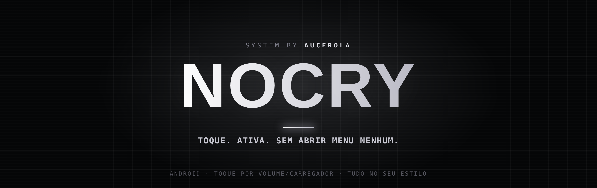
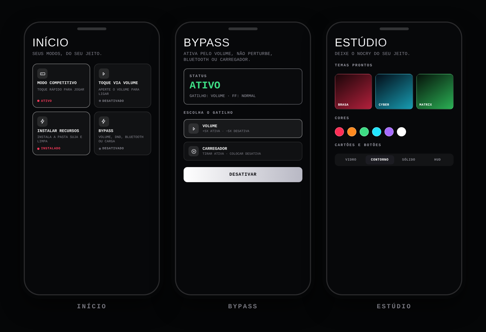

## O que é isso

O NOCRY é um app que eu fiz pra parar de depender do Termux pra configurar o celular antes de jogar. Tudo que eu fazia na mão — toque rápido, ajustes de tela, otimizar o fundo, preparar o Free Fire — virou um app só, com interface, sem precisar abrir terminal nenhum.

Dá pra ligar os modos pelo próprio toque físico do celular (volume, carregador, bluetooth, não perturbe), sem precisar nem abrir o app depois de configurado uma vez. E todo o visual é customizável: tema, cor, fonte, fundo animado — fica do seu jeito.

## Imagens

## Como instalar

1. Vá em **[Releases](https://github.com/aucerolanocry/Nocry/releases/latest)** e baixe o `Nocry.apk`.
   Link direto: `https://github.com/aucerolanocry/Nocry/releases/latest/download/Nocry.apk`
2. Instale (o Android vai pedir pra liberar "instalar apps desconhecidos" — é só autorizar).
3. Abra o app, digite sua **Key** e toque em **Entrar**.
4. Toque em **Configurar e conectar** e siga os 6 passos que o app mostra na tela (ligar depuração sem fio, parear, conectar, liberar permissão, ligar o acessibilidade, liberar notificação). Leva menos de 2 minutos.
5. Pronto — a partir daqui é só usar os modos.

> A depuração sem fio do Android desliga quando troca de Wi-Fi ou reinicia o celular. Quando isso acontecer, só precisa ligar de novo — o pareamento fica salvo.
>
> No Android 13+, se a opção de Acessibilidade aparecer cinza: **Configurações → Apps → Nocry → ⋮ → Permitir configurações restritas.**

## Como usar

**Toque rápido (Modo competitivo / Volume / Carregador)** — liga o toque mais responsivo da tela sem precisar abrir o app: aperta o volume ou pluga o carregador e já ativa.

**Modo carregador** — ajusta a densidade da tela e abre o Free Fire direto quando você pluga o carregador.

**Otimização** — congela os apps que ficam abertos em segundo plano, pra liberar RAM e processamento antes de jogar. Dá pra proteger os apps que você não quer que sejam fechados.

**Instalar recursos** — baixa e instala a pasta suja (usada pelo Bypass) e a pasta limpa (pra voltar ao normal depois), tanto pro FF Normal quanto pro FF Max. Direto pelo app, sem precisar mexer em pasta nenhuma na mão.

**Bypass** — ativa pelo volume (aperta um número de vezes que você escolhe), não perturbe, bluetooth ou carregador. Escolhe o Free Fire (Normal/Max) e o tipo (Completo/Normal/Simples) antes de ativar.

**Estúdio** — muda tudo do visual: 8 temas prontos, cor própria, fundo animado ou com vídeo/imagem da sua galeria, fonte, cartões em 4 estilos, brilho, borda, vibração e a intro de abertura (com música própria ou a sua).

**Ajustes do toque** — define quanto tempo de toque longo e multi-toque cada modo usa.

Todo mundo que quer só usar o app para por aqui — o resto é por minha conta.

## Key

O acesso é por Key: dono, staff ou usuário. Cada key vale pra 1 celular e pode ter validade. Sem internet o app continua valendo por 3 dias depois da última confirmação.

## Atualização

O app confere sozinho se saiu versão nova e avisa na hora — não precisa ir atrás. Quando sai, ele já baixa e instala o APK novo direto pelo app, sem precisar abrir o navegador.

## Limitações

- Precisa de Android 8 ou mais novo (o pareamento por código usa a depuração sem fio do Android 11+).
- O desfoque do fundo precisa do Android 12 ou mais novo.
- Os ajustes rodam via ADB do próprio aparelho — o efeito varia um pouco por marca/versão do Android.

<b>Detalhes técnicos (build, assinatura e servidor) — pra eu não esquecer depois</b>

### Gerar e publicar uma versão nova

O build roda pelo GitHub Actions: aba **Actions → Gerar APK do Nocry → Run workflow**, coloco a versão (ex.: `1.0.0`) e deixo "Publicar" marcado. Compila, assina e já sobe em **Releases** em uns 5 a 10 minutos.

A chave de assinatura fica nos *Secrets* do repositório (nunca no código, que é público), em 4 valores: `KEYSTORE_B64`, `KEYSTORE_PASS`, `KEY_ALIAS`, `KEY_PASS`. É ela que garante que a versão nova instala por cima da antiga sem precisar desinstalar — se eu perder essa chave, quem já tem o app instalado vai precisar desinstalar pra receber uma versão assinada com outra.

### Key e servidor

A Key é conferida num servidor próprio (Cloudflare Worker + banco D1). O servidor assina a resposta e o app confere com uma chave pública embutida — a chave privada fica só no Cloudflare, nunca no app.

- **Dono** (a `OWNER_KEY`): cria, desativa e apaga qualquer key, vê todos os registros.
- **Staff**: cria e gerencia keys de usuário.
- **Usuário**: usa o app. Cada key vale pra 1 celular e pode ter data de vencimento.
- Cada entrada registra IP, marca/modelo do celular, versão do Android e do app e um código anônimo do aparelho — nada de telefone, localização, contatos ou lista de apps.

Como o código é público, dá pra qualquer um recompilar sem Key — ela protege quem usa o APK oficial.

## Créditos

ADB embutido: [libadb-android](https://github.com/MuntashirAkon/libadb-android) (Apache-2.0 / GPL-3.0). Fontes dos 11 pacotes do Estúdio: todas sob SIL Open Font License 1.1 (lista completa em `app/src/main/assets/fonts/FONTES-LICENCAS.txt`).

---

feito por <b>aucerola</b>

