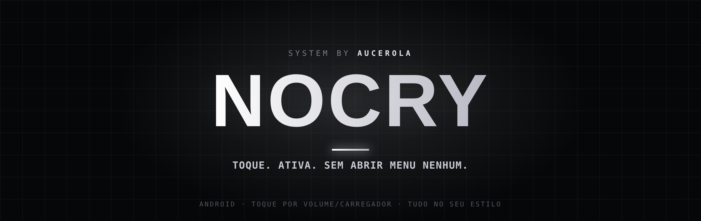
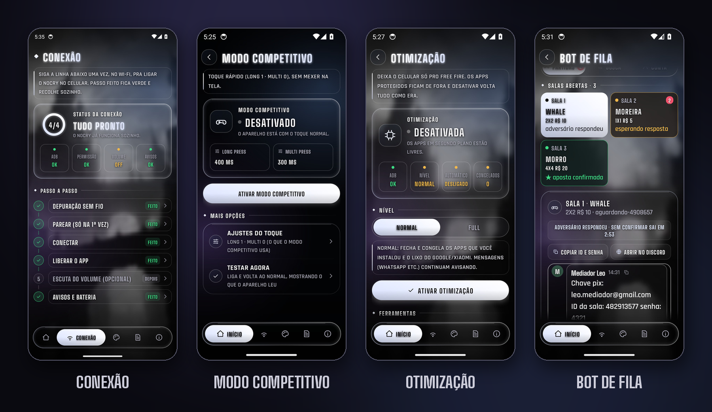
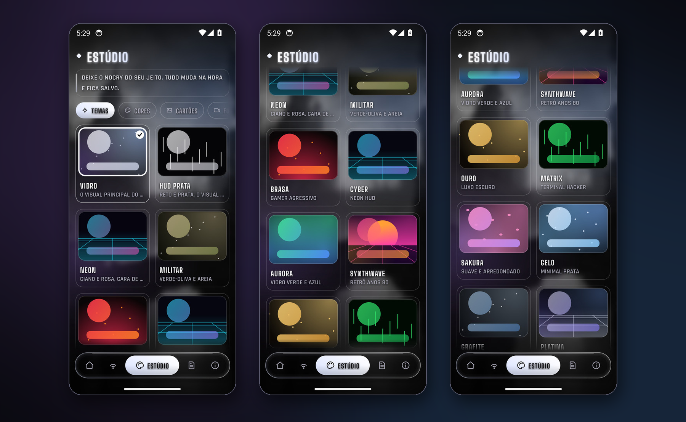

**[Baixar o app](https://github.com/aucerolanocry/Nocry/releases/latest/download/Nocry.apk)**

## O que é

O NOCRY junta num app só tudo que eu fazia no Termux antes de jogar: toque mais rápido, ajuste de tela, limpar o que fica aberto no fundo e deixar o Free Fire pronto. Sem terminal, sem digitar comando.

Depois de configurar uma vez, dá pra ligar os modos pelo próprio celular (volume, carregador, bluetooth ou não perturbe), sem nem abrir o app.

## O que tem

| | |
|---|---|
| **Modo competitivo** | Toque mais rápido na tela. Liga pelo app ou pelo volume/carregador. |
| **Otimização** | Congela os apps que ficam abertos no fundo e libera memória. Os apps de mensagem e o Google Meet já vêm protegidos. Desligou, tudo volta como era. |
| **Ajustes do toque** | Tempo do toque longo e do multi-toque de cada modo. |
| **Instalar recursos** | Baixa e instala as pastas do FF Normal e do FF Max direto pelo app. |
| **Bypass** | Ativa pelo volume, não perturbe, bluetooth ou carregador. |
| **Bot de fila** | Acompanha as filas e salas do Discord, mostra o chat da sala e manda a mensagem automática já marcando o jogador. |
| **Estúdio** | Tema, cores, fonte, cartões transparentes, fundo com vídeo ou imagem da galeria e intro de abertura. |

## Visual

Os cartões vêm transparentes pra aparecer o fundo. Quem quiser mais escuro muda em **Estúdio › Cartões › Opacidade dos cartões**.

## Como instalar

1. Baixe o **[Nocry.apk](https://github.com/aucerolanocry/Nocry/releases/latest/download/Nocry.apk)**.
2. Instale. O Android vai pedir pra liberar "instalar apps desconhecidos", é só autorizar.
3. Abra, digite sua **Key** e toque em **Entrar**.
4. Toque em **Configurar e conectar** e siga os passos da tela (depuração sem fio, parear, conectar e liberar as permissões). Leva uns 2 minutos.

> A depuração sem fio desliga quando troca de Wi-Fi ou reinicia o celular. Aí é só ligar de novo, o pareamento fica salvo.
>
> Android 13 ou mais novo: se o Acessibilidade aparecer cinza, vá em **Configurações › Apps › Nocry › ⋮ › Permitir configurações restritas**.

## Atualizações

O app avisa sozinho quando sai versão nova e já baixa e instala por dentro dele. Dá pra deixar pra depois por até 3 horas; passou disso, a atualização fica obrigatória.

## Key

O acesso é por Key (dono, staff ou usuário). Cada Key vale pra 1 celular e pode ter validade. Sem internet, o app continua funcionando por 3 dias depois da última confirmação.

## Requisitos

- Android 8 ou mais novo (o pareamento por código usa a depuração sem fio do Android 11+).
- Fundo desfocado só no Android 12 ou mais novo.
- O efeito dos ajustes pode variar um pouco de marca pra marca.

<b>Pra mim (build e servidor)</b>

### Gerar versão

**Actions › Gerar APK do Nocry › Run workflow**, sempre na branch `sniper`:

- Testar só eu: marcar **so_dono** e desmarcar **publicar**.
- Lançar pra todo mundo: marcar **publicar**.

A chave de assinatura fica nos *Secrets* (`KEYSTORE_B64`, `KEYSTORE_PASS`, `KEY_ALIAS`, `KEY_PASS`). Sem ela, versão nova não instala por cima da antiga.

### Servidor

A Key é conferida num Cloudflare Worker com banco D1. A resposta vem assinada e o app confere com a chave pública que fica dentro dele; a privada fica só no Cloudflare. Cada entrada guarda IP, modelo do celular, versões do Android e do app e um código anônimo do aparelho. Nada de telefone, localização, contatos ou lista de apps.

## Créditos

ADB embutido: [libadb-android](https://github.com/MuntashirAkon/libadb-android) (Apache-2.0 / GPL-3.0). Fontes do Estúdio sob SIL Open Font License 1.1 (lista em `app/src/main/assets/fonts/FONTES-LICENCAS.txt`).

feito por <b>aucerola</b>

